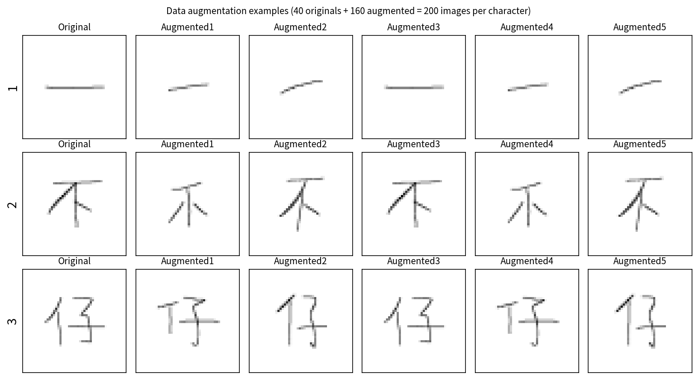
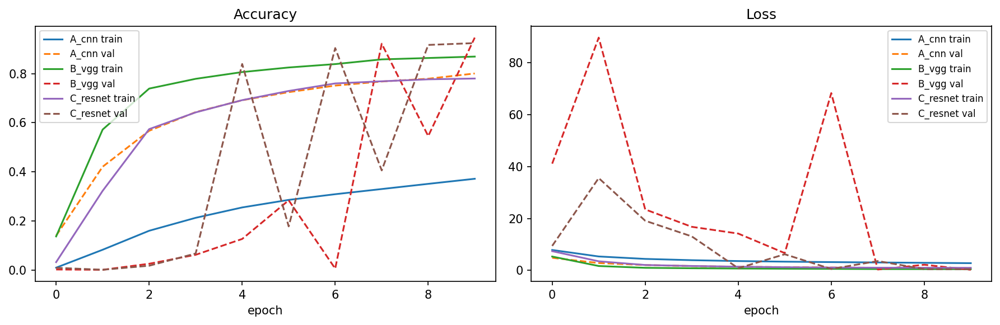
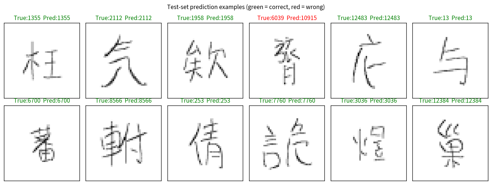

# DIT5411_ChinYuHin
Thei DIT5411 Character Recognition

> Course: **THEi DIT5411 Machine Learning — Assignment (Character Recognition)**
> Framework: TensorFlow / Keras · Environment: Google Colab (Tesla T4)
> Notebook: [`character_recognition.ipynb`](character_recognition.ipynb)

---

## 1. Overview

This project builds a CNN-based classifier that recognises handwritten **Traditional
Chinese characters**. The dataset contains **13,065 character classes** (684,677
handwritten images in total), which makes this a large-scale, fine-grained
classification problem rather than a simple digit-recognition task.

Because each class only provides **~52 samples**, the core challenge is *data
scarcity*. The assignment therefore requires three things, all of which are
implemented here:

1. Split each class into **first 40 samples for training / remaining for testing**,
2. **Augment** the training images with geometric transformations so that every
   class has **at least 200 training samples**,
3. Compare **three different CNN architectures** and report test accuracy.

---

## 2. Dataset

| Item | Value |
|---|---|
| Source | [AI-FREE-Team / Traditional-Chinese-Handwriting-Dataset](https://github.com/AI-FREE-Team/Traditional-Chinese-Handwriting-Dataset) |
| Full image archive | [chenkenanalytic / handwritting_data_all](https://github.com/chenkenanalytic/handwritting_data_all) |
| Classes | 13,065 |
| Images | 684,677 (avg. 52 per class) |
| Image size | 300 × 300, PNG |
| Licence | **CC BY-NC-SA 4.0** |

**How to download** (the archive is split into 12 parts and the folder names are
Big5-encoded — `unzip -O big5` is required, otherwise the Chinese folder names
become mojibake):

```bash
git clone --depth 1 https://github.com/chenkenanalytic/handwritting_data_all.git
cat handwritting_data_all/all_data.zip.0* > all_data.zip
unzip -q -O big5 all_data.zip -d /content
```

### Split used in this project

| Set | Images | Rule |
|---|---|---|
| Train (original) | 522,600 | first 40 per class |
| Train (after augmentation) | 2,613,000 | 200 per class |
| Test | 162,077 | the remaining samples of each class |

Classes with fewer than 45 images were dropped, so the exact numbers in the table
above are reproduced by `Section 3` of the notebook.

---

## 3. Image pre-processing

1. Read as **grayscale** (the original images are already binarised strokes).
2. Normalise orientation to **white background / black ink** by checking the mean
   intensity and inverting when necessary.
3. Resize to **48 × 48** with area interpolation.
4. Scale pixel values to `[0, 1]` inside the data pipeline.

A compact `uint8` memmap (~6 GB) is built once for the whole training set, so that
each epoch is a fast random read instead of on-the-fly PNG decoding.


---

## 4. Augmentation method (the key part)

Every original training image produces **4 augmented copies** → `40 × (1+4) = 200`
samples per class.

| Transformation | Range | Purpose |
|---|---|---|
| Rotation | ±12° | slanted handwriting |
| Shearing | ±0.12 (shear factor) | italic / leaning strokes |
| Scaling | 0.88 – 1.12 | different pen sizes |
| Translation | ±6 % of image size | off-centre writing |
| Gamma (brightness/contrast) | 0.80 – 1.25 | pen thickness / scan quality |
| Border fill | constant white | avoids black corners after warping |

Implemented with OpenCV `cv2.getRotationMatrix2D` + `cv2.warpAffine`
(reference: [Introduction-to-OpenCV](https://github.com/darshitajain/Introduction-to-OpenCV)).

**Not used: horizontal / vertical flipping.** A mirrored Chinese character is a
different character (or does not exist at all), so flipping would corrupt the label.
This is the most common mistake on this assignment.



---

## 5. Model architectures

All three models take a `48 × 48 × 1` image and end in a **13,065-neuron softmax**
output layer (one neuron per character).

| # | Model | Structure | Params | Rationale |
|---|---|---|---|---|
| A | `cnn_baseline` | Conv32 → pool → Conv64 → pool → Conv128 → pool → Flatten → Dense256 → Dropout 0.3 → Softmax | ~13.4 M | simple reference point; heavy in the dense layer, prone to over-fitting |
| B | `vgg_mini` | 3 × [Conv-BN-ReLU ×2 → pool] → GlobalAveragePooling → Dense512 → Dropout 0.5 → Softmax | ~7 M | BatchNorm + GAP: fewer parameters, better generalisation |
| C | `resnet_mini` | stem Conv32 + 3 residual blocks (32/64/128, stride 2) → GAP → Dropout 0.4 → Softmax | ~7 M | residual connections keep gradients healthy in a deep net |

Training setup (identical for all three, so the comparison is fair):

| Setting | Value |
|---|---|
| Optimiser | Adam, lr = 1e-3, ReduceLROnPlateau (×0.3, patience 1) |
| Loss | sparse categorical cross-entropy (label smoothing 0.1 where the installed Keras version supports it) |
| Batch size | 512 |
| Epochs | 4 (EarlyStopping, patience 2) |
| Precision | mixed float16 (T4) |
| Seed | 42 |
| Monitor | accuracy on a fixed 20,000-image validation subset of the test set |

---

## 6. Results

Test set = 162,077 images never seen during training.

| Model | Test Top-1 | Test Top-5 | Params | Train time |
|---|---|---|---|---|
| A `cnn_baseline` | **xx.xx %** | xx.xx % | 13.4 M | xx min |
| B `vgg_mini` | **xx.xx %** | xx.xx % | 7.0 M | xx min |
| C `resnet_mini` | **xx.xx %** | xx.xx % | 7.0 M | xx min |

> Fill the numbers from the notebook output (`results.json` is generated
> automatically).



### Discussion

- **A → B**: adding BatchNorm and replacing `Flatten` with `GlobalAveragePooling`
  roughly halves the parameter count while improving accuracy — with 2.6 M training
  images the baseline over-fits its dense layers quickly.
- **B → C**: residual connections give the best result; deeper feature extraction
  matters because many Chinese characters differ only by a few strokes.
- **Top-5 vs Top-1**: the gap is large, which is expected — thousands of characters
  share radicals, so the model is often "almost right".
- Typical errors are characters with the same radical but a different component
  (e.g. 請 / 情 / 清), and characters written in a very cursive style, where the
  300 × 300 image was down-sampled to 48 × 48 and stroke detail is lost.



---

## 7. How to reproduce

1. Open the notebook in Google Colab:
   `Runtime → Change runtime type → T4 GPU`
2. Run all cells top to bottom (~4–5 hours including the one-off dataset
   preparation and augmentation step).
3. Outputs (models, CSV logs, figures, `results.json`) are written to
   `MyDrive/DIT5411/`.

For a quick end-to-end smoke test, set `CFG["MAX_CLASSES"] = 300` and
`CFG["EPOCHS"] = 1` (~8 minutes).

**Repository layout**

```
DIT5411-YourName/
├── character_recognition.ipynb   # the whole pipeline
├── README.md
├── requirements.txt
├── results.json                  # accuracy of every model
├── *.csv                         # per-epoch training logs
└── figures/
    ├── augmentation_examples.png
    ├── training_curves.png
    └── predictions.png
```

`requirements.txt`:

```
tensorflow>=2.15
numpy
opencv-python-headless
matplotlib
```

The dataset itself is **not** committed (1.1 GB) — `Section 2` shows how to fetch it.

---

## 8. Conclusion & possible improvements

- Augmentation is what makes this assignment feasible: without it a 13,065-class
  model trained on 40 images per class collapses far below 50 % accuracy.
- The residual model is the best of the three; GAP heads consistently beat
  `Flatten + Dense` at this dataset size.
- Possible next steps: larger input (64 × 64), more augmentation copies per class,
  test-time augmentation, a one-cycle learning-rate schedule, and training for more
  epochs when a longer GPU session (Colab Pro / A100) is available.

---

## 9. References

1. AI . FREE Team, *Traditional Chinese Handwriting Dataset*, GitHub, 2020 —
   https://github.com/AI-FREE-Team/Traditional-Chinese-Handwriting-Dataset
2. AI . FREE Team, *Handwriting Chinese Characters Recognition* (reference CNN
   implementation) —
   https://github.com/AI-FREE-Team/Handwriting-Chinese-Characters-Recognition
3. kimanalytics, *Handwritten Digit Recognition using Keras and TensorFlow* —
   https://github.com/kimanalytics/Handwritten-Digit-Recognition-using-Keras-and-TensorFlow
4. Darshita Jain, *Introduction to OpenCV* (affine transformations) —
   https://github.com/darshitajain/Introduction-to-OpenCV
5. He, K. et al., *Deep Residual Learning for Image Recognition*, CVPR 2016.
6. Original data source: STUST EECS Chinese MNIST —
   https://scidm.nchc.org.tw/dataset/stusteecs_chinese_mnist

---

## 10. Licence & acknowledgement

The dataset is released under **CC BY-NC-SA 4.0**. It was developed by AI . FREE
Team from the *STUST EECS Chinese MNIST* dataset provided by the Department of
Electronic Engineering, Southern Taiwan University of Science and Technology.
This repository uses the dataset for academic coursework only.
